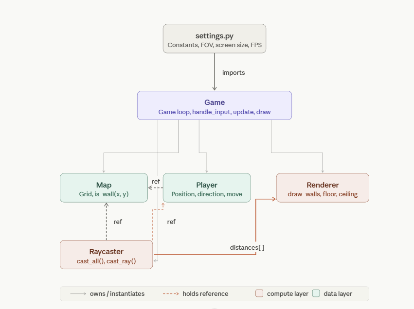

# 3D maze using raycasting

## How to install it

Check out the requirement.txt file and run the adaquate commmands
(Claude, Help me on this)

## How to run it 

Dont really now yet. I guess just run the main.py file

## The design 

Raycasting is implemented using DDA (Digital Differential Analyzer) with make the wall detection  more efficient than a regular raycast

